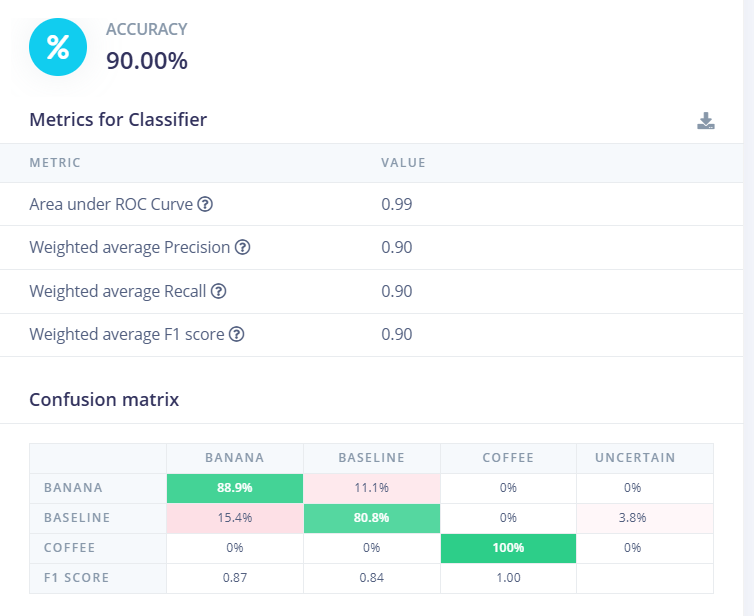

# Project report — *SNIFF32*

**Team:** Niklas Etling, Nikita Toporkov, Eemeli Vartio

> **Two pages maximum.** I read the first two pages; anything after that I don't.
> Writing short is harder than writing long — that's the point. Delete these
> quote blocks as you go.
> Most of this you have already written during the course. Copy it in:
> the platform sentence from your `README`, `threat-model.md`, `data-plan.md`,
> your confusion matrix screenshot, and `ceiling.md` if it's relevant.

## What it does

**SNIFF32** is a TinyML embedded project developed for the Embedded Programming 2 course. It utilizes an ESP32-S3 microcontroller and a 5-sensor gas array to detect, classify, and identify various odors including ambient air, fresh banana, and coffee grounds.

## How it works

> One short paragraph: sensor → model → action. A diagram or the pipeline in
> one line is fine. Say what the board is doing, not how Edge Impulse works.

ESP32 streams gas-sensor array's analog readings → model detects from these the gasses → after detection the identified class is displayed.

## Data

> How you collected it, how many examples per class, and who recorded them.
> From `data-plan.md`, updated to what you actually did — the plan and the
> reality are rarely identical, and the difference is worth a sentence.
### TODO(Niklas)
Initially we collected 5 recordings of each classs with 15 seconds per class at 50Hz. The data consists of 5 sensor delta values which are the difference between a baseline air (5 second recording before object in vicinity), and the peak gas levels of introduced substance. For example: The device is plugged into power and left running until sensor levels drop to a consistent level. 

### Collection TODO(Niklas)
For collecting the data we used modified code from lecture 2 materials, where we collected the gesture tinyML datasets. Filtering was added for the data-stream program that runs on the ESP32 while recording is done with a laptop using a Python program. Recording program runs a realtime graph of the data-stream to inspect data readings during and between measurements. Baseline readings are recorded before measuring organic samples. Delta of these 2 are used as the dataset with 5 samples to train per class. Recordings and final version of the recording program were made by Niklas. AI was used in the programming tasks.

### Collection set-up
1. Capture the average clean air reading for 5 seconds to establish the `baseline_air` value for the delta calculation.
2. Place funnel, inverted cup with the bottom cut off, over the gas-emitting item and the sensor array on the top where the bottom was cut off.
3. Wait for the gases to build up in the enclosure and allow the sensors to reach a stable peak readings.
4. Use a Python script to record 15 seconds of the plateaued peak readings into a CSV file.
5. Remove the funnel cup, fan the sensors back to baseline, and repeat.

### Classes
*   **Baseline - Pure classroom air (ambient environment)** 
*   **Class 1 - Ground coffee**
*   **Class 2 - Banana fruit**

### From plan to reality
Our plan moved to using the raw readings from sensors, not converted to accurate voltage changes. Getting the baseline back after data recordings turned out to be slower and harder than expected. 

## Results — honestly

Even with high accuracy in the confusion matrix, our model stubles on the sensors not getting back to baseline fast enough.

> Your confusion matrix, and the accuracy you actually get. Then the important
> part: **what does it get wrong, and why?** A model with a known weakness you
> can explain scores better here than a suspiciously perfect one.

## The two sentences

> Copy them in. If they no longer describe what you built, fix the sentence.

- **Platform:** We use ESP32, because its computation power and memory handle our analog sensor outputs with ease, there is no need for a big ML model. Power consumption is low and MCU keeps it readily and quickly available. 
- **Threat model:** asset: the proprietary TinyML sniffing model intellectual property, personal data from Edge Impulse, LAN. · threat: competitors within the product segment, malicious actors who compromise the system through direct physical or network access · response: physical and network access to sensor array strictly restricted and secured.

## What was hard, and what you'd do next

At the start sensors need 24-48 hours to be burned. We had to burn the sensors again after the first because we did not notice tiny films on top of gas champers. Burning was done multiple times because the sensor readings didn't get back to ambient levels after measurements. This meant data collection was slow and inconsistent. With more time we would reconsider which sensors to use and how to create stable data-collection environment. With more time to collect data more accurate model is possible to make. Getting the ESP32 to send data wirelessly would make collecting and sampling easier. 

> 3–4 sentences. The honest part. What fought you, what you'd change with
> another week, what you'd do differently from the start.

## Who did what

> One line per person, agreed by the whole team. Not percentages — a plain
> sentence each, naming what that person actually did.
>
> *Example: "Anna — sensor wiring, the recording sessions, threshold experiments.
> Ben — Edge Impulse training, the deployment build, the demo script."*
>
> Everyone's name appears, and everyone sees it before it is handed in.

- **Niklas:** — Sensor selection, sensor wiring, finalized version for data collection and data-stream program, the recording sessions main recorder, assingment and report writing, Edge Impulse model training.
- **Nikita:** — Sensor selection, the recording sessions assistance, assingment and report writing.
- **Eemeli:** — Sensor wiring, the recording sessions assistance, coding first versions of recording program and initial tests and data-stream program, assingment and report writing.

## AI use

AI was used in the planning of what sensors to use and what substances emit which gasses, programming tasks, spellcheking and sentence structure.

> Required. A few sentences: what you used it for, and where. Reporting never
> costs marks; not reporting is fraud.
